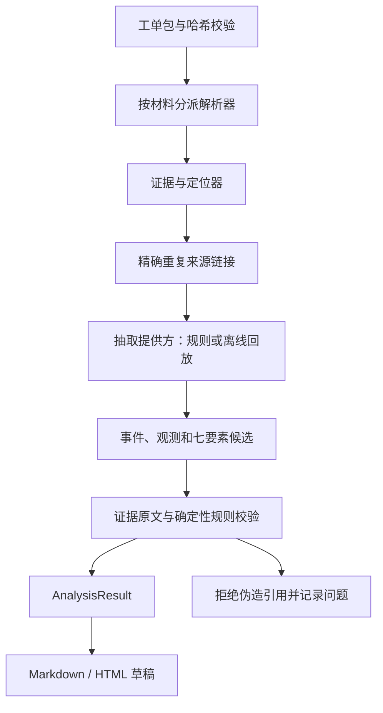

# 0005 文本链路采用保守规则、证据校验与快照回放

- 日期：2026-10-27
- 阶段：A1
- 状态：已采纳
- 相关：`ARCHITECTURE_OPTIONS.md` §5.4、§6，`CONTRACTS.md`，`A1_TEXT_PIPELINE.md`

## 背景

A0 已确定工单包、七要素与证据接口；A1 和 A2 同时开发，需要让文本链路在附件未交付时也能实际运行。S01/S09 的“原因”是检查结果，S06 的字段与客户时间不同，S10 的拆机记录是服务身份问题，P01 有负历时，P03 有恶意指令。直接照抄字段或让模板重新总结原文会掩盖这些差异。

## 可选方案

| 方案 | 做法 | 代价 |
| --- | --- | --- |
| 全部交给在线模型 | 原文直接抽七栏，再生成报告 | 依赖服务和数据出口；难以稳定复现失败；不能用于未批准外发的真实材料 |
| 每种材料自行生成七栏 | 文本、附件各出一份结论再合并 | 与 A0 契约冲突，来源编号、未知和冲突语义容易分叉 |
| 统一证据 + 可替换抽取 + 统一规则 + 模板 | 解析器只产证据；本阶段交付 `rules` 和 `replay`；固定规则后渲染报告 | 规则基线词法覆盖有限，后续模型质量需独立评测 |

## 选择及理由

采用第三种方案，不修改 A0 公共结构。

1. **保留语义，再选结论。** 系统字段、告警、客户陈述和流程时间各自入候选。冲突不给值；系统恢复时间可以是 documented，只有明确客户确认才能由自动流程升为 confirmed。检查正常、自恢、拆机与缺联系人分别归类，不能作为根因。
2. **事件使用可核对的原文。** 日志的主体和记录时间来自同条元数据，动作保留正文；正文里的业务时刻另外进入带语义的时间候选，不把记录时间冒充发生时间。未来计划保留 planned，重复事件保留来源关系。
3. **原文不删除。** 签名、引用和摘要仍进证据索引；它们不增加独立佐证。精确重复链接 `derived_from`，不能可靠定位来源的 AI 摘要不伪造链接。命中嵌入指令的整行保留在证据中，但不用于结论。
4. **回放绑定实际输入。** 回放记录包含 manifest 哈希、证据快照哈希和结构化抽取结果。换材料或解析方式后旧回放会拒绝；不能把固定答案当作新模型效果。
5. **规则独立于提供方。** 引用存在、原文与归一值一致、候选选择及关键语义都要校验。提供方伪造引用会整份拒绝；有效的业务冲突保留候选并进入草稿，供人工处理。
6. **报告不二次生成事实。** Jinja2 只读经过 schema 校验的结果，提供阶段报告与结案草稿。HTML 显式转义，Markdown 转义标签与语法；HTML/CSS 分文件，证据链接跳到同页来源索引。
7. **质量门槛是工程假设。** `needs_review` 或质量分低于 0.7 的片段不进入自动结论。依据：工程判断，优先避免低质量读数产生确定性结论；分数不是正确概率，也没有在真实样本上校准。

## 后果与代价

- 本地规则可以运行、解释和回归，但不能替代真实语言理解质量评测。模糊语义可能漏抽或出现多余提示；同义原因只对有限明确类别归并，复杂冲突交给人工。
- 裸时刻需要日期锚点；邮件先按明确时区换算日期，跨午夜的起障告警可引用匹配字段补齐。无法消除的日期或时区歧义保留说明，不按城市猜时区。
- A2 的图像/PDF/DOCX/EML 尚未交付时，相关结论只能未知或保留文本可得信息；不能为通过标准答案硬编码附件内容。
- A3 的并发修订、权限与批准不属于无服务端的 A1；实施计划 §7 的最后两项保留给 A3 验证，不能宣称本阶段已经通过。
- 本阶段未接外部模型，不涉及外发请求或限流等待；以后新增提供方必须复用 A0 闸门及用户规定的 MiniMax 节流规则。
- 失败尝试：Jinja2 按 `.html` 扩展名自动判断时，实际模板名是 `.html.j2`，转义测试发现漏洞；改为按导出格式显式启用自动转义。邮件最初直接套 UTC 邮件头日期，跨日测试发现错误；改为先转换到正文明确时区。普通回复分隔线与 From 头最初被编号为两条引用，改为一次消息边界。
