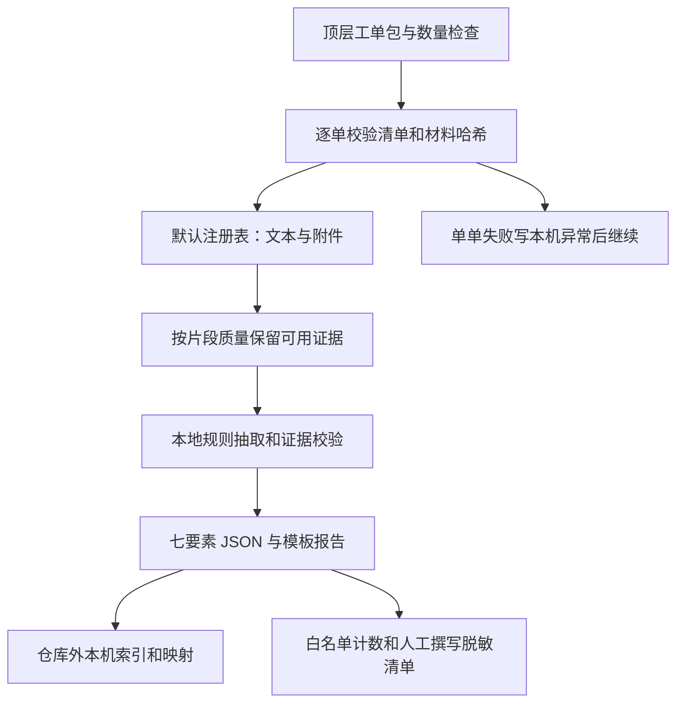

# 0006 本机全流程联调与局部证据可用性

- 日期：2026-10-27
- 阶段：A1/A2 合并联调
- 状态：已采纳
- 相关：`CONTRACTS.md`、`INTEGRATION_ISSUES.md`

## 背景

A1 测试刻意固定文本注册表，属于文本消融；A2 独立测试材料解析。两者通过仍不足以证明附件已参与七要素。真实工单没有 gold，用户选择先跑通后自行对照，真实输入和输出仅限本机。

A2 为 EML 未覆盖子附件、PDF 某页 OCR 失败等返回 `needs_review`，可靠正文和不确定区域各有片段标志；A1 却把整件全部片段改成待复核，导致可靠正文也被屏蔽。

## 选择

继续使用唯一 `EvidenceSpan` 接口和默认注册表，新增 `noc7 local-batch` 本机编排层，不引入模型服务、数据库或另一套七要素 schema。

1. **分开完整性与可信度。** `parsed` / `needs_review` 保留解析器的片段标志；`failed` / `unsupported` 的残留片段全部隔离。未解析的子附件不会因此变为已解析，材料复核提示始终存在。
2. **在来源处标明不确定性。** EML 替换解码、兼容换行或 MIME 正文缺陷隔离对应正文；未解析 MIME 部件仍为衍生、待复核片段。未分类图片、照片和复合历史文档的全部片段先待关联审核，高 OCR 分数不能证明属于本次故障。混合质量终端截图/曲线保留可靠片段，读数仍受解析器质量门槛约束。
3. **不混入旧结果。** 只扫描顶层，可要求恰好 15 包；输出必须是新建仓库外目录，与输入互不包含。每单异常仅在本机保存并继续，批次有失败则返回非零；已有输出拒绝复用。
4. **分开真实身份与可提交统计。** 本机 `mapping.json` 保存编号、路径和输入哈希，报告保存正文。`summary.json` 仅允许枚举、计数和本轮代号。提交的 Markdown 根据计数与代码分析撰写，不复制来源字段值、异常或真实报告。
5. **分层报告验证结果。** pytest、浏览器边界检查、包/schema 校验、默认全链路合成 gold 对照分别陈述。新增 `scripts/check_integration.py` 显示语义差异并返回非零；不修改 gold 来消除差异，也不将真实无标准答案解释为准确率 100%。

## 代价与边界

- 英文地点漏抽、不同措辞产生冲突等仍列在问题清单。报告生成成功仅说明链路完成运行。
- 源响应留档的 `other` 单列，不作为业务材料完整解析率分母；材料清单仍显式提示不支持，不掩盖未消费字段。
- 曲线首次非零和 EML 附件递归未实现；真实 PDF/DOCX 无样本。本轮不引入外部服务。
- 代号仅对该批次有效，改变输入集合后应创建新批次，再借本机映射查看。
- 基线与最终报告均保留仓库外，便于复核 Q01 的证据变化，真实产物不发布到项目预览或文件页。

## 验证

新增 7 项集成测试，覆盖默认解析器的合成附件进入候选和报告、EML 正文/子附件隔离、不确定解码、PDF 局部故障、混合图片质量、批次失败继续、禁网运行、数量与仓库输出限制。完整结果和未解决差异见 [联调问题清单](../INTEGRATION_ISSUES.md)。
