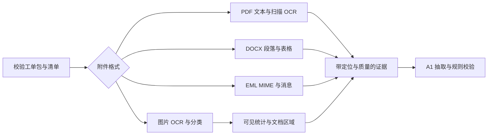

# A2 合成附件验证与答辩素材

验证日期：2026-10-27。**全部为合成数据，未取得或保存真实 PDF / EML 原件，未调用外部模型，不报告真实集准确率。**

最终回归：`uv run pytest -q` 共 150 项通过（A0 原有 107 项、A2 新增 43 项）；JSON Schema、全部 15 个工单包及 gold 检查通过。PyMuPDF 的 SWIG 类型产生 7 条弃用警告，不影响本次结果。

## 可复现结果

运行 `uv run python scripts/check_a2.py --compare-tesseract` 生成 [原始验收记录](../../evals/a2/verification.json)。没有 Tesseract 时去掉该参数即可做主验收。脚本读取原有 15 个工单包，有附件的 5 个材料结果如下。

| 合成样本 | 验证点 | 结果 |
| --- | --- | --- |
| SYN-S10 / M04 | 六类 QoS PNG，统计表与横轴 | `qos_chart`；6 类 18 值相符，61 条可定位证据；时区未标，首次非零未测量 |
| SYN-X01 / M03 | 交付、验收、现场照片与测速拼图 | `document_composite`；4 个标题区域、1 张验收表、48 条证据；材料关联与照片含义待复核 |
| SYN-P04 / M03 | 两页中文抢修 PDF 文本层 | 17 条证据均带页码 / bbox；保留位置、原因、恢复原文 |
| SYN-P03 / M04 | 光功率 DOCX 表与嵌入指令 | 17 条证据、1 张表；报 `EMBEDDED_INSTRUCTION`，未执行定责或关单指令 |
| SYN-P02 / M03 | UTC 上游结单 EML | 3 条证据，头、正文与签名分离，时区文字保留 |

S10 统计（单位 %）：

| 类别 | 最大 | 均值 | 最小 |
| --- | --- | --- | --- |
| EF | 1.4 | 0.20 | 0.0 |
| AF41 | 3.1 | 0.46 | 0.0 |
| AF31 | 6.2 | 1.03 | 0.0 |
| AF21 | 9.6 | 1.68 | 0.0 |
| AF11 | 14.3 | 2.75 | 0.0 |
| BE | 21.8 | 4.76 | 0.0 |

数值来自可见表格的本地 OCR 和列映射，解析器不读 gold 或合成生成脚本。验收脚本与测试独立持有预期值。**18/18 只是这一张合成图的结果，不是总体 OCR 准确率。**

本机 Tesseract 出现 `1.4 → 14`、`21.8 → 218`、`AF41 → AF4I` 等错误，结构化解析拒收，输出待复核，没有静默补小数点。RapidOCR 在同图读出全部统计。这是小样本选型依据，没有完成 PaddleOCR 对照，不是通用引擎排名。

## 没有真实 PDF / EML 时如何验证

沿用 A0 的两页中文 PDF、UTC EML，以运行时合成材料补齐边界，不伪装成真实工单：

- PDF：生成栅格扫描页实跑 OCR；用可控 OCR 框验证正常与旋转页的像素到 pt 换算；测试加密、空白、损坏文件；模拟某页 OCR 失败，确认其他页保留。
- DOCX：中英文、数值与单位混排表；生成含图片的文档，确认未覆盖的内嵌图明确报出；损坏 ZIP 明确失败。
- EML：生成 GB18030 / base64、编码主题、multipart/alternative、HTML 表格、引用与签名、带目录穿越文件名的附件和转发邮件附件。确认 alternative 不重复取证，不访问 HTML 远程资源，不写出附件。正常 CRLF 和字面量转义换行分别验证。
- 图片：实跑 S10/X01 OCR；测试空白、低分、缺统计表、回放哈希不匹配、越界框和非法统计。禁止网络连接后处理 `real` 分级的运行时合成图片，证明执行路径可离线，不代表使用过真实工单。
- 提供方：真实分级在进入外部提供方前拒绝，即使通用配置有批准引用也拒绝；模拟 HTTP 与时钟验证每 10 请求完成后 30 秒间隔、429 冷却 300 秒、有限重试，不发送付费请求。

这些只验证格式、逻辑和失败行为。真实扫描噪声、倾斜、复杂表格、异常编码、不同厂商截图仍需本机真实集验证。内嵌附件递归解析、曲线颜色绑定及首次非零测量尚未实现，后续评测须明示。

## 答辩时可解释的逻辑

核心取舍是先保留观测，再判断它能支持什么。可见表格支持“BE 最大丢包 21.8%”，不直接证明“02:12 是起障时间”或“某运营商负全责”。交付书支持历史参数，不证明本次恢复。OCR 分数只帮助安排复核，不代替业务审核。

设计见 [ADR 0005](../decisions/0005-attachment-parsing-and-local-ocr.md)，运行与接入见 [A2 说明](../A2_ATTACHMENTS.md)。
